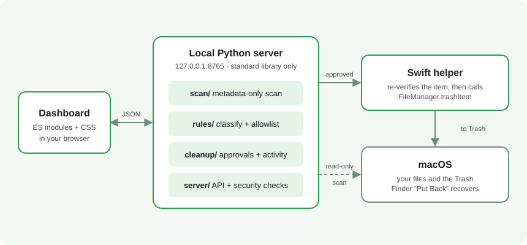

<p align="center">
  
</p>

# Mac Tidy

<p align="center">
  <b>See where your Mac's storage went, and clean it up one reviewed item at a time</b>
</p>
<p align="center">
  A local dashboard that measures your disk, suggests safe caches to remove, and only ever moves things to the Trash.
</p>

<div align="center">

  
  
  
  

</div>

<br>

## &nbsp; The Problem
Freeing space on a Mac is oddly risky. The usual tools each get one part wrong.

<table width="100%">
  <tr>
    <td width="33%" valign="top" align="center">
      <br>
      <h3 align="center">&nbsp; Where did it go?</h3>
      <p align="center">"System Data" is a black box. You can't tell whether 180 GB is a build cache or something you need.</p>
      <br>
    </td>
    <td width="33%" valign="top" align="center">
      <br>
      <h3 align="center">&nbsp; One-click cleaners</h3>
      <p align="center">Bulk removal can hide consequences. A wrong selection can cost you real data; each Mac Tidy move gets an explicit review.</p>
      <br>
    </td>
    <td width="33%" valign="top" align="center">
      <br>
      <h3 align="center">&nbsp; Your data leaves</h3>
      <p align="center">You should be able to inspect a storage tool and know whether it reads file contents or sends data away. Mac Tidy performs its analysis locally.</p>
      <br>
    </td>
  </tr>
</table>

<br>

## &nbsp; The Solution
Mac Tidy treats cleanup as a **review problem**, not a deletion problem. It measures first, explains every location in plain words, and puts you in the loop for each move. Nothing is deleted: approved items go to the Trash, where Finder's **Put Back** restores them.

- **Local only.** A small server on `127.0.0.1` serves the dashboard. No accounts, no telemetry, no third-party packages.
- **Review first.** Every move needs a preview, a checkbox and a single-use approval that expires after five minutes.
- **Allowlist, not blocklist.** Only recognised caches, logs, supported regenerable developer folders and your own Downloads/Documents/Desktop files can be offered. Everything else is refused.

### How it works
<p align="center">
  
</p>

1.  **Scan:** The scanner walks your home folder, `/Applications`, `/Library` and a few system paths. It reads metadata only, never file contents, never follows symlinks, stays on one volume and counts hard links once. Sizes are allocated bytes (`st_blocks × 512`).
2.  **Classify:** Each folder and file is labelled by a rule table: cache, logs, downloads, developer data, backup, system, or "keep unless unneeded", with advice for each.
3.  **Suggest:** Caches of 50 MB or more become suggestions. A cache nested inside another suggestion is counted once.
4.  **Preview:** You pick an item. The server checks the allowlist again from the path alone, fingerprints the item (device, inode, modification time, size, no symlinks) and issues a random approval key. Nothing has moved yet.
5.  **Approve:** You tick a confirmation that you've stopped the app or no longer need the file. The key is single-use and tied to this scan. The server re-checks the fingerprint.
6.  **Move:** The Swift helper checks the fingerprint once more, then calls Apple's `FileManager.trashItem`. The move is written to an activity log so you can find it later.
7.  **Recover or reclaim:** Use **Activity & Recovery** to show the item in Trash and Put Back, or empty Trash yourself and rescan to observe the change in available space. Mac Tidy never empties Trash.

<br>

## &nbsp; Security Model

| **Concern**                | **What Mac Tidy does**                                                                                      |
| :------------------------- | :---------------------------------------------------------------------------------------------------------- |
| **Network exposure**       | Binds to `127.0.0.1` only. Requests must carry an allowed `Host`, which blocks DNS rebinding.               |
| **Other websites**         | Every mutating request needs a matching `Origin` and a per-process session token, which blocks cross-site requests. |
| **Wrong item**             | The browser sends an item's index and path. The server uses its own report and refuses if they disagree.   |
| **Item changed after review** | The fingerprint is checked at approval and again inside the helper. A changed item needs a fresh review. |
| **Symlinks**               | Refused anywhere in an item's path.                                                                         |
| **Crash or Control-C mid-move** | The helper runs in its own session, and shutdown waits for an in-flight move to be recorded.          |
| **Permanent loss**         | Nothing is deleted. Items go to the Trash and stay recoverable.                                             |
| **Your data**              | Nothing leaves your Mac. Scan results and the activity log live in `~/Library/Application Support/Mac Tidy/`. |

### What can be moved to Trash
Only items inside your home folder that match the allowlist:

- individual app caches under `~/Library/Caches/…`, plus npm, pip, uv and Webpack build caches
- individual folders under `~/Library/Logs/…`
- individual files in Downloads, Documents and Desktop

These are always refused: system locations, Apple-managed data, whole `Library` or `Caches` folders, credentials (`.ssh`, `.aws`, `.gnupg`), source control (`.git`), the Trash itself, hidden personal files, anything reached through a symlink, and anything *inside* an app or library package (`.app`, `.photoslibrary`, `.fcpbundle` and similar). See [SECURITY.md](SECURITY.md) for the full model and its known limits.

<br>

## &nbsp; The Dashboard

| **View**                  | **What it shows**                                                                   |
| :------------------------ | :---------------------------------------------------------------------------------- |
| **Overview**              | Free space, the largest cleanup opportunity, app caches and large app data          |
| **Review Cleanup**        | Independent cache suggestions with exact paths, sizes and reasons                   |
| **Browse Storage**        | A drill-down treemap of scanned folders                                             |
| **Large Files**           | The 1,500 largest files, searchable and filterable                                  |
| **All Candidates**        | Caches, logs, downloads, developer data and backups to review                       |
| **Activity & Recovery**   | Completed moves, and whether each item is still in Trash                            |
| **Scan Details**          | Coverage, unreadable locations and why totals can't match macOS exactly             |

Moving an item to Trash does not free space until you empty Trash. Rescan afterwards to measure the result.

<br>

## &nbsp; Tech Stack
No runtime dependencies. The Python standard library, plain ES modules and CSS, and one small Swift file.

| **Component**        | **Technology**                                                                           | **Description**                                                                   |
| :------------------- | :--------------------------------------------------------------------------------------- | :-------------------------------------------------------------------------------- |
| **Server**           |                       | Python 3.10+, `http.server`. Scan, rules, approvals, activity log and the JSON API. |
| **Dashboard**        |                  | Vanilla ES modules. `core/` state, `components/`, one module per `views/` screen.  |
| **Native helper**    |                  | One Swift file: reveal in Finder, and move to Trash after re-verifying the item.   |
| **Icons**            |  | Apple SF Symbols, exported to PNG and drawn as CSS masks so they follow the theme. |

<br>

## &nbsp; Getting Started

### Requirements
- macOS
- Python 3.10+
- Xcode Command Line Tools (`xcode-select --install`), which includes `make` and the Swift compiler used to build the helper

### Run it

```bash
git clone https://github.com/Hemachandra9899/Mac-Tidy.git mac-tidy
cd mac-tidy
make run
```

`make run` builds the helper on first use, starts the server and opens <http://127.0.0.1:8765>. Press Control-C to stop. You can also double-click **Start Mac Tidy.command**.

If port 8765 is busy, choose another local port:

```sh
MAC_TIDY_PORT=8800 make run
```

Then open <http://127.0.0.1:8800>. Host, Origin and session checks use the chosen port too.

### Install as a command

```bash
make helper && pip install .
mac-tidy              # or: mac-tidy --no-open
```

### A note on measurement
Allocated sizes are estimates. APFS clones, compression, snapshots and privacy-protected folders mean totals can't be reconciled exactly with macOS Storage settings, and what you reclaim may be less than what's shown. Granting your terminal Full Disk Access (optional) lets the scan read more locations.

<br>

## &nbsp; Project Layout

```
src/mac_tidy/
  cli.py            command-line entry point (`mac-tidy`, `python -m mac_tidy`)
  config.py         paths, host and port
  rules/            what a path holds (classify) and whether it may be trashed (policy)
  scan/             metadata-only filesystem scan and the browsable report
  cleanup/          moving items to Trash
    fingerprint.py    prove a later move targets the same item
    approvals.py      single-use, expiring approvals
    activity.py       persistent log of completed moves
    native.py         bridge to the Swift helper
  server/           app.py (state and use cases), http.py (routing, headers), static.py
  common/           atomic JSON file writes
  web/
    js/
      core/           api, state, selectors, format (no DOM)
      components/     reusable UI pieces: dialog, toast, metrics, item table, folder row…
      views/          one module per dashboard screen
      app/            render, actions, events, server sync
    styles/           base, layout, components, views, dark theme, responsive
    icons/            SF Symbols exported as PNG masks
native/
  MacTidyHelper.swift   reveal in Finder, move to Trash (re-verifies identity)
```

Dependencies point one way: `rules` ← `scan`, `cleanup` ← `server` ← `cli`; and on the frontend `core` ← `components` ← `views` ← `app`. See [CONTRIBUTING.md](CONTRIBUTING.md) to get involved.

<br>

## &nbsp; Roadmap
- [x] **Scan:** metadata-only, no symlinks, hard links counted once, partial coverage flagged
- [x] **Explain:** every location classified with plain-language advice
- [x] **Review-first Trash:** preview, confirmation, single-use expiring approval
- [x] **Identity check:** fingerprint verified by the server and again by the native helper
- [x] **Recovery:** activity log with live "still in Trash" status and Show in Trash
- [x] **Package protection:** nothing inside an app or library bundle can be moved
- [x] **Light and dark appearance**, responsive layout
- [x] **Screenshots** in this README
- [ ] **Signed and notarised release** so it can be double-clicked without building
- [x] **Exact duplicate files and inspect-only folder comparison**
- [x] **Per-app, developer and older-file insights; real scan trends**
- [ ] **Scheduled rescans** with a quiet notification when a cache grows large

These last items are ideas, not commitments.

<br>

## &nbsp; Acknowledgements
- [Apple SF Symbols](https://developer.apple.com/sf-symbols/): the interface icons
- [Apple's storage guidance](https://support.apple.com/en-us/102624): the reference for how macOS accounts for space

Mac Tidy is released under the [MIT License](LICENSE).

<br>

<div align="center">

[](mailto:pottingari@gmail.com)

</div>

<p align="center">
  <sub>Made with &nbsp;<sub></sub>&nbsp; for tidy Macs</sub>
</p>


## Storage insights

| View | What it answers |
| --- | --- |
| **Apps** | Measured app bundle + matched Caches, Support, Containers and other Library locations. Shared/ambiguous folders stay unassigned rather than guessed. |
| **Developer** | Tool-specific explanations and top-level project dependencies. Possible inactivity is based on the latest observed modification, never assumed from access time. Docker disks and release archives stay managed by their owning tools. |
| **Older Files** | Large local personal files unchanged for 90/180/365/730 days. Modified age is not proof the file is unused. |
| **Duplicates** | Explicit, cancellable SHA-256 file searches and exact folder-tree comparisons, with a 2/8/32 GB read budget. Choose a keeper before reviewing another file. |
| **Trends** | Up to 60 real capacity snapshots and changes between comparable complete folders. No fabricated history or “you freed X” attribution from background free-space changes. |
| **Free Space Explained** | Native macOS capacity estimates, readable Trash size, and local Time Machine snapshot names. Snapshots are not deleted. |

### Duplicate-search scope and limits

The regular scan remains metadata-only. It retains the 1,500 largest files and a separate bounded index of up to 10,000 local personal files of at least 1 MB. **Duplicate search is the explicit exception that reads content**, only when started. It uses size and edge samples, then full SHA-256 hashes; changing files, symlinks, cloud placeholders, dependency trees, hidden paths and app/library packages are excluded. **Anything inside a code project is skipped too** (a folder with `.git`, `package.json`, `Cargo.toml`, an Xcode project and similar above it), because projects keep intentional copies, such as `public/` and `dist/` holding the same image, and removing one breaks the project. The result tells you how many were skipped. Hard links are counted as one file.

Folder verification checks relative names (including empty folders) and full file hashes among complete size-matched personal-folder candidates. It checks at most 100 groups and 10,000 entries per folder, within the selected read budget. Folder results are inspection-only: the app does not grant a broad whole-folder deletion permission. File duplicate removal revalidates the selected keeper and uses the existing per-item Trash approval flow. APFS clones/shared blocks mean repeated logical content is not guaranteed reclaimable disk space.

The API provides `/api/insights`, `/api/trends`, `/api/space`, and `/api/duplicates`. Starting/cancelling duplicate searches and reviewing duplicate removal are authenticated POST actions. No AI model, account, telemetry or external analysis server is used.

Research notes and implementation limits are in [docs/product-research.md](docs/product-research.md).
